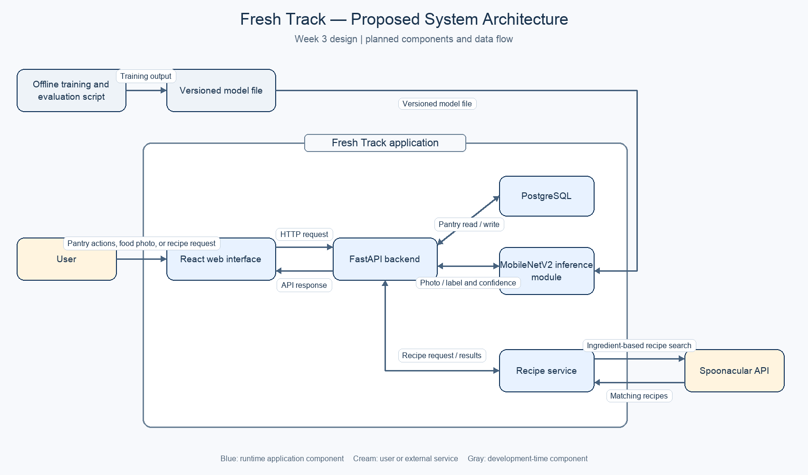

# Methodology and System Design

## Methodology

Fresh Track will be developed incrementally. The first prototype will implement a pantry workflow: a user enters a food name and expiry date, the backend validates and stores the item, and the web interface displays the saved record. Later development will add recipe suggestions and photo-based ingredient classification. This staged approach allows the core data flow to be demonstrated before adding external API and machine-learning features.

## Proposed System

Fresh Track is a proposed web application for household pantry tracking and food-waste reduction. Users will be able to add pantry items with expiry dates, view their pantry, request recipes based on available ingredients, and upload food photos for ingredient classification. The first version will not include user accounts, barcode scanning, grocery-store integrations, or nutrition tracking.

## System Architecture

Figure 3.1 shows the proposed system architecture. The user interacts with the React web interface, which sends requests to the FastAPI backend. The backend stores and retrieves pantry records in PostgreSQL. For photo classification, the backend communicates with a MobileNetV2 inference module. For recipe suggestions, the recipe service sends ingredient-based searches to the external Spoonacular API and returns results through the backend. Model training and evaluation are performed separately; the resulting versioned model file is used by the inference module.

**Figure 3.1. Proposed Fresh Track system architecture.**

The React interface runs in the user's browser. The backend, database, and inference module are planned server-side components; their hosting location has not yet been selected. Spoonacular is an external service. Pantry items will be stored in PostgreSQL. Uploaded photos will be processed for classification and then discarded; a predicted ingredient will be stored only after user confirmation.

## Technology Selection and Design Decisions

PostgreSQL was selected for pantry storage instead of CSV or JSON files because it supports structured records and indexed queries, including ordering items by expiry. The loading-time target still needs to be measured during implementation. See [PostgreSQL documentation on indexes and ORDER BY](https://www.postgresql.org/docs/current/indexes-ordering.html).

Transfer learning with a pre-trained MobileNetV2 model was selected instead of training an image classifier from scratch. Reusing features from a pre-trained model is suitable when the project dataset is limited. The classifier must still be evaluated using a fixed train/test split; the accuracy target is not assumed to have been met. See the [TensorFlow transfer learning guide](https://www.tensorflow.org/guide/keras/transfer_learning).

## Design Risks and Limitations

The image classifier may perform below the 85% top-1 accuracy target. It will be evaluated on a fixed held-out dataset of at least 100 images, and low-confidence predictions will allow manual entry.

Spoonacular may be slow or unavailable. The application will handle timeouts or failed requests with a clear message. Pantry management should remain usable when the recipe service is unavailable.

This architecture is proposed design work. The hosting setup, final database schema, and measured performance remain to be confirmed during implementation.
